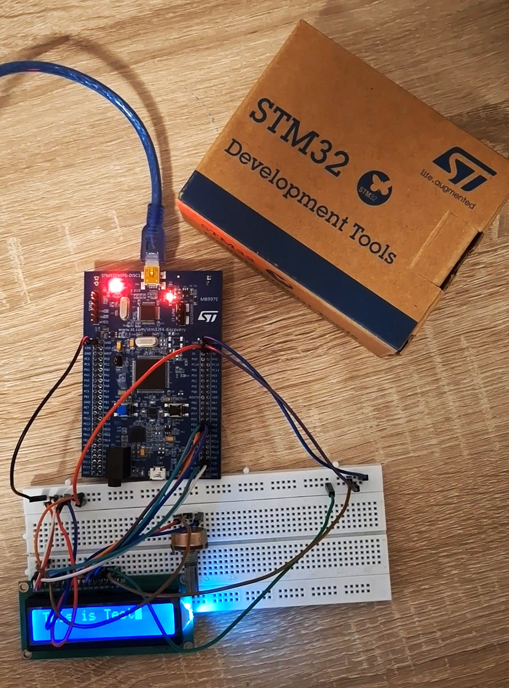

# 1-ALCD: 16x2 Character LCD Driver for STM32F407

A small, dependency-free driver for HD44780-compatible character LCDs (16x2),
written for the STM32F407VG using the STM32 HAL. The LCD is driven in 4-bit
mode with plain GPIO, so no special peripheral is required.

Compatible with and tested on both **STM32CubeIDE** and **Keil uVision 5**
(Arm Compiler 6).



## Hardware

| Part | Details |
|---|---|
| Board | STM32F407G-DISC1 (STM32F407VG), programmed over the on-board ST-Link via USB |
| Display | 16x2 HD44780-compatible character LCD with backlight |
| Contrast | 10 kΩ potentiometer on the LCD Vo pin |
| Supply | LCD powered at 5 V, with a common ground with the board |

### Pin connections

The pins are defined in `ALCD/ALCD.h`. Change the macros there if you wire
the display differently.

| LCD pin | Signal | STM32 pin |
|---|---|---|
| RS | Register select | PD11 |
| RW | Read/Write | PD10 |
| EN | Enable | PD12 |
| D4 | Data 4 | PD1 |
| D5 | Data 5 | PD2 |
| D6 | Data 6 | PD3 |
| D7 | Data 7 | PD4 |

> Check this table against the macros in `ALCD.h` for your build. D0 to D3 are
> not used in 4-bit mode.

## Communication protocol

The LCD uses a parallel interface, not a serial bus. The driver works like this:

- **4-bit mode.** Each byte is sent as two nibbles, high nibble first, over D4 to D7.
- **RS** selects the target register: low for a command, high for character data.
- **RW** is held low, so the driver only writes to the LCD and never reads the busy flag (Connected to Ground in my Setup).
- **EN** latches each nibble on its falling edge. The driver pulses it high and then low.
- **Timing.** Because the busy flag is not read, the driver waits a fixed time after each
  command (about 75 µs for most commands and about 4 ms for Clear and Home).

Initialization follows the HD44780 sequence: three `0x30` commands to force
8-bit mode, then `0x20` to switch to 4-bit mode, then Function Set (2 lines,
5x8 font), Display Off, Clear, and Display On.

For more information, refer to the datasheet of HD44780.

## Software structure

```
1-ALCD/
├── ALCD/
│   ├── ALCD.c        LCD driver implementation
│   └── ALCD.h        Public API and pin/timing configuration
├── Core/             Application code (main.c) and CubeMX-generated files
├── Drivers/          STM32 HAL and CMSIS
└── *.ioc             STM32CubeMX project
```

| Layer | Purpose |
|---|---|
| `main.c` | Application: calls the ALCD API |
| `ALCD.c / ALCD.h` | LCD driver: pin setup, 4-bit write, init sequence, text output |
| STM32 HAL | GPIO access (`HAL_GPIO_Init`, `HAL_GPIO_WritePin`) |

### API

```c
void ALCD_init(uint8_t col, uint8_t row);                 // initialize the display
void ALCD_Clear(void);                                    // clear the screen
void ALCD_goto(uint8_t x, uint8_t y);                     // move the cursor
void ALCD_putChar(char c);                                // print one character
void ALCD_puts(const char *str);                          // print a string
void ALCD_putCharXY(uint8_t x, uint8_t y, char c);        // character at a position
void ALCD_putsXY(uint8_t x, uint8_t y, const char *str);  // string at a position
void ALCD_putNum(int32_t num);                            // print an integer
void ALCD_printf(const char *fmt, ...);                   // formatted output
```

### Example

```c
#include "ALCD.h"

ALCD_init(16, 2);
ALCD_goto(0, 0);
ALCD_puts("Library");
ALCD_putsXY(0, 1, "Hello STM32");
ALCD_printf("%d", 42);
```

The driver tracks the cursor position and wraps to the next line at the end
of a row.

## Build and run

**STM32CubeIDE**
1. File → Import → Existing Projects into Workspace, and select the `1-ALCD` folder.
2. Build, then Run or Debug.

**Keil uVision 5**
1. Open the Keil project, or create one for `STM32F407VGTx` with the HAL sources from `Drivers/`.
2. Add `ALCD/ALCD.c` and the include path `ALCD/`.
3. Build, then download with the ST-Link debugger.

## Tested

| Toolchain | Result |
|---|---|
| STM32CubeIDE (GCC) | Working |
| Keil uVision 5 (Arm Compiler 6) | Working |

Hardware: STM32F407G-DISC1 and a 16x2 LCD.

## Notes

- Keep the busy-wait delays in mind when changing the system clock(168 MHz). They are
  calibrated from `SystemCoreClock`.
- Adjust the contrast potentiometer if the display looks blank.
